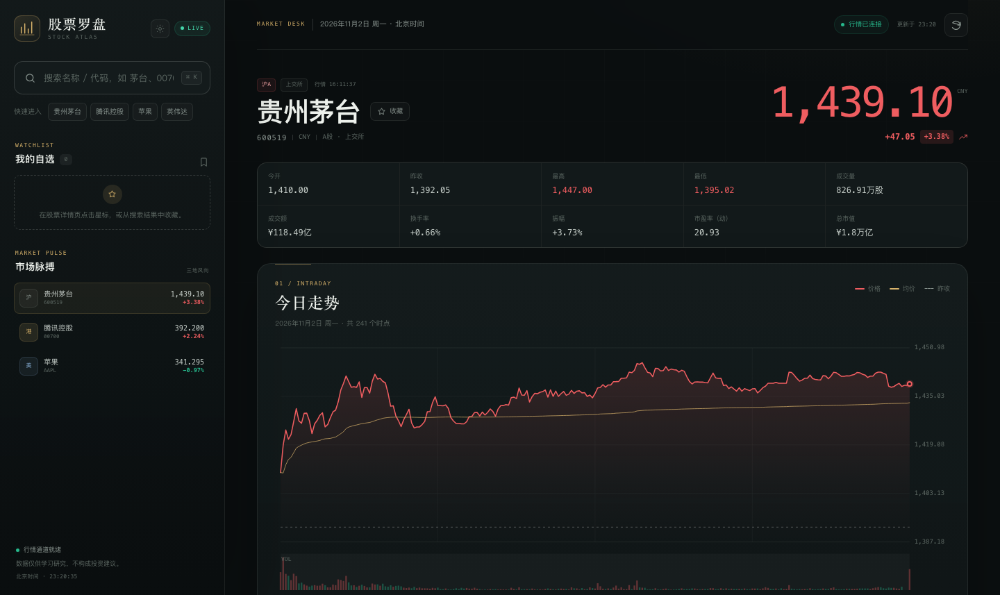
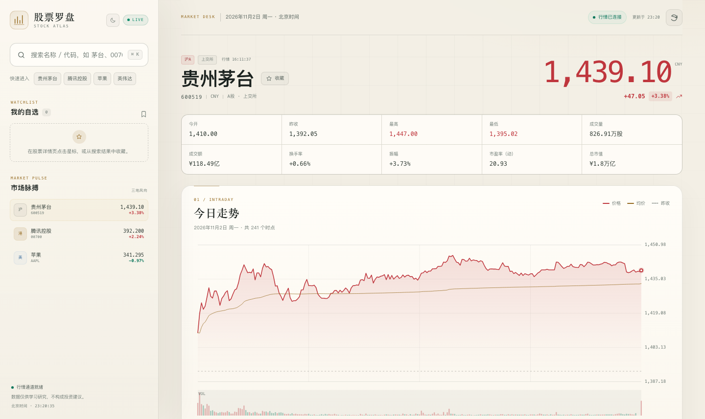
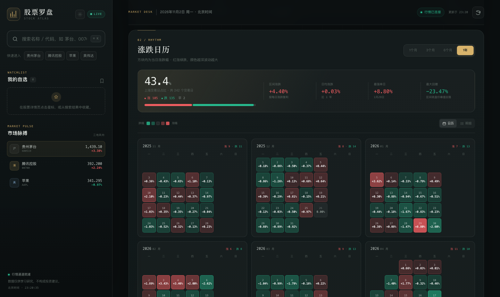
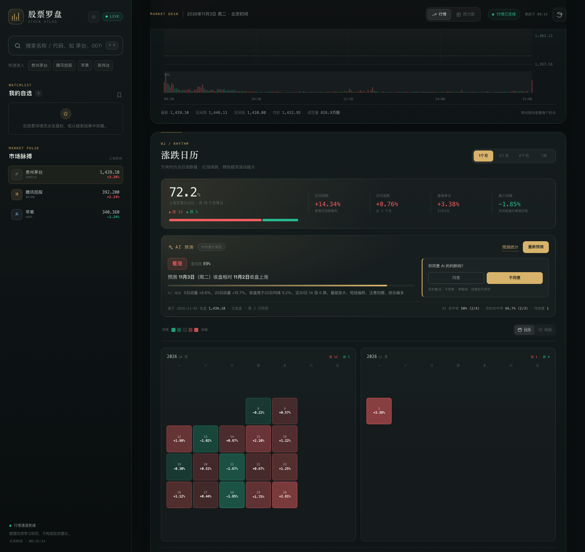
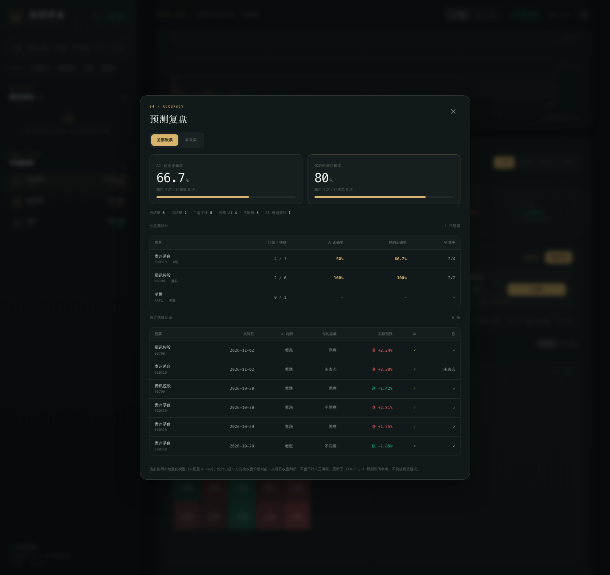
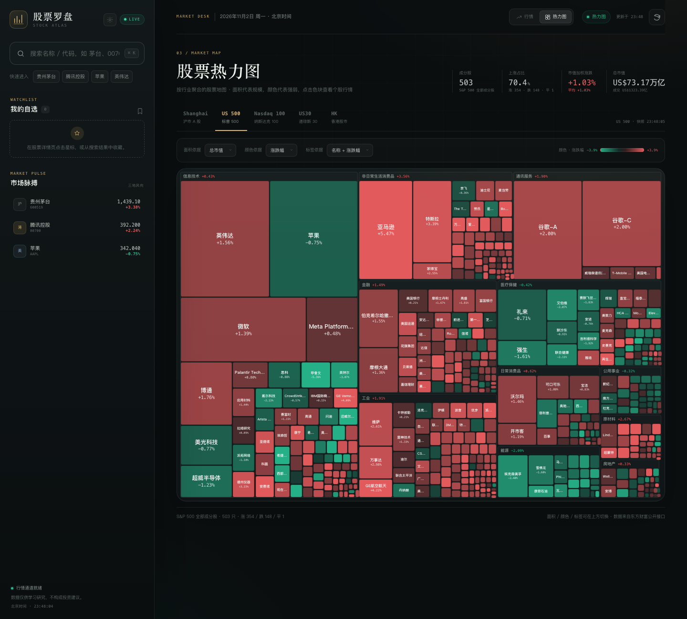
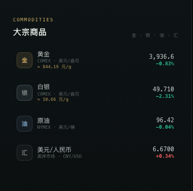
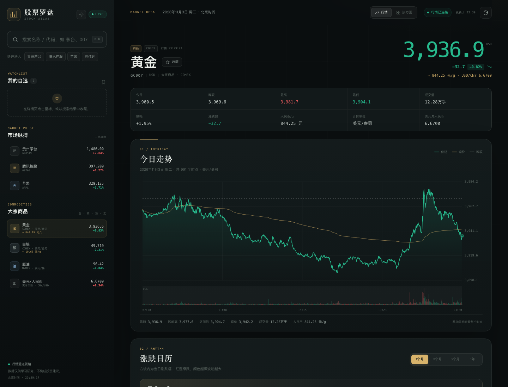
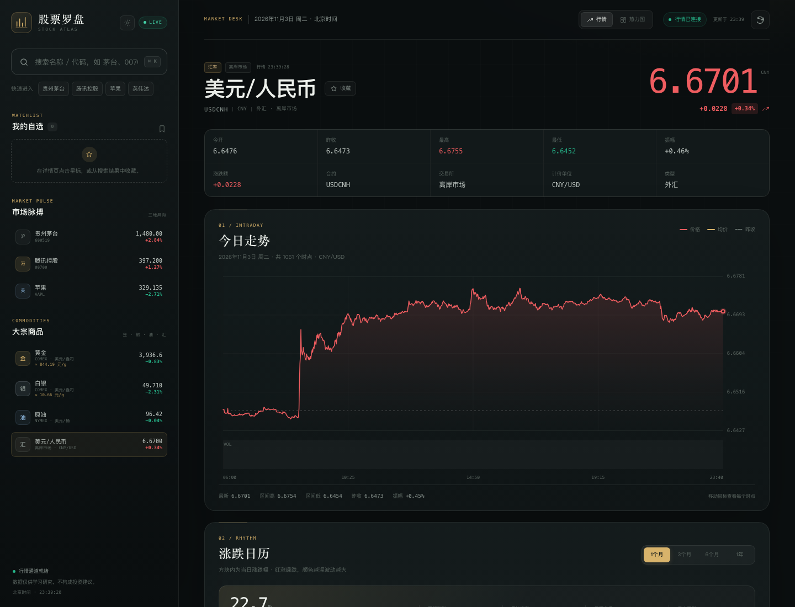
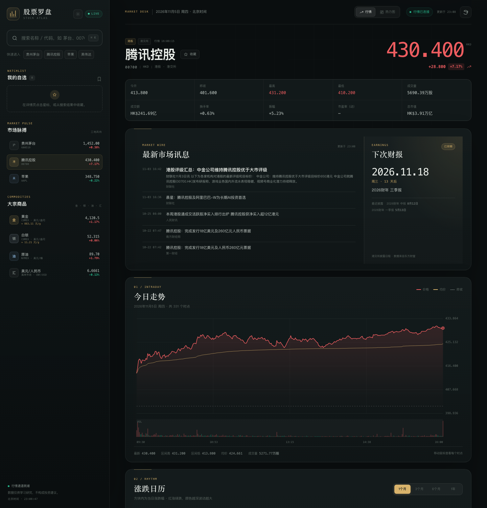

# 股票罗盘 · STOCK ATLAS

一个本地运行的跨市场股票行情观察台。用原生 HTML / CSS / JavaScript 构建界面，用 Python 标准库写一个轻量行情代理，把东方财富的公开行情数据整理成统一格式。

支持 **沪深京 A 股、香港股市、美国股市**，同时跟踪 **黄金、白银、原油** 的国际基准价格与 **美元兑人民币汇率**；包含搜索、当天分时、近 1 / 3 / 6 / 1 年每日涨跌日历、AI 次日涨跌预测与命中率复盘、Shanghai / US 500 / Nasdaq 100 / US30 / HK 五大市场股票热力图、本地自选股，以及深色 / 浅色双主题。













---

## 快速启动

要求：**Python 3.9+**，不需要安装任何第三方依赖。

```bash
# 在项目根目录（README.md、server.py 所在目录）下执行
python3 server.py --open
```

浏览器会自动打开 <http://127.0.0.1:8765>。如果不想自动打开，直接运行：

```bash
python3 server.py
```

macOS 也可以直接双击 **`start.command`**；Linux / macOS 终端可运行 `./start.sh`。

> 不要直接双击 `index.html`。页面需要本地服务提供 `/api/*` 行情代理，直接以 `file://` 打开会无法请求数据。

其他启动参数：

```bash
python3 server.py --port 9000        # 换一个端口
python3 server.py --host 0.0.0.0     # 允许局域网访问（仍从 127.0.0.1 打开）
python3 server.py --quiet            # 不输出访问日志
```

---

## 功能

### 1. 跨市场股票搜索

- 输入股票名称、代码或拼音首字母，例如 `茅台`、`600519`、`00700`、`AAPL`、`GZMT`。
- 覆盖：
  - 沪市 / 深市 / 北交所 A 股
  - 港股（自动排除窝轮、牛熊证等非股票标的）
  - 美股（纳斯达克、纽交所、美交所）
- 搜索结果按市场筛选，并优先展示代码或名称完全匹配的结果。
- 搜索面板支持方向键选择、回车打开、`Esc` 关闭，快捷键 `⌘K` / `Ctrl+K` 聚焦搜索框。

### 2. 当天走势

- 分时价格线、均价线、昨收基准线。
- 下方成交量柱状图，按价格涨跌染色。
- 鼠标悬浮查看每个时点的价格、均价、较昨收涨跌和成交量。
- 顶部展示今开、昨收、最高、最低、成交量、成交额、换手率、振幅、市盈率和总市值。
- 分时数据自动刷新（每 60 秒，页面隐藏时暂停）。

### 3. 每日涨跌日历

- 切换 **1 个月 / 3 个月 / 6 个月 / 1 年**。
- 每个方块代表一个交易日，方块内显示当日涨跌幅：
  - **红色 = 上涨**
  - **绿色 = 下跌**
  - **灰色 = 平盘**
  - 颜色越深，单日波动幅度越大。
- 按自然月分组的日历布局，并给出每月上涨 / 下跌天数。
- 顶部汇总：上涨交易日占比、区间涨跌（按每日涨跌复利）、日均涨跌、最强单日、最大回撤。
- 悬浮 / 键盘聚焦方块可查看当日开高低收、成交量和成交额。
- 可切换“明细”表格，查看每一天的完整数据。
- 日历内嵌 **AI 预测**：只判断下一交易日收盘是涨还是跌，生成一次即写入本地 SQLite，点击“重新预测”才会覆盖；同时可以记录“同意 / 不同意 AI 的看法”，并在该交易日收盘后自动补上实际涨跌。

### 4. AI 预测与命中率复盘

- 预测对象是**下一根已出现的日 K 之后的交易日**：开盘前预测今天，盘中预测明天，收盘后预测下一交易日。
- 结果包含方向（看涨 / 看跌）、置信度、不超过 80 字的理由、预测目标日、基准收盘价和生成时间。
- **只预测一次**：首次点击“AI 预测下一交易日”后结果会缓存到 `data/predictions.db`，之后打开页面直接读取，不会重复调用大模型；点击“重新预测”才会重新生成并更新同一条记录。
- **用户态度**：在待结算的预测上选择“同意 / 不同意”，系统会记录用户实际押注的方向（同意 = 跟 AI 同向，不同意 = 反向）。
- **自动结算**：当预测目标交易日的日 K 收盘后，读取行情时自动把实际涨跌、实际涨跌幅、实际交易日写入数据库；盘中不会提前结算，遇到休市会顺延到下一根真实日 K。
- **命中率统计**：
  - AI 预测正确率 = AI 猜对次数 / 已结算且非平盘的预测次数；
  - 用户预测正确率 = 用户押对次数 / 已结算且已表态且非平盘的次数；
  - 平盘（涨跌幅为 0）不计入正确率，单独展示；
  - 支持“全部股票”和“本股票”两个范围，并给出分股票明细和最近结算记录。
- 重新预测时，如果方向或目标日发生变化，会清空之前的用户态度（避免旧表态被错误沿用）；方向不变则保留。
- 未配置大模型 Key 时自动使用**本地量化模型**（动量、均线偏离、涨跌宽度、量能、短线反转），完全离线可用。

### 5. 市场热力图

- 顶部“行情 / 热力图”标签页切换，支持五个市场：
  - **Shanghai**：沪市主板 + 科创板，按总市值取前 500 只
  - **US 500**：S&P 500 全部成分股
  - **Nasdaq 100**：Nasdaq-100 全部成分股
  - **US30**：道琼斯工业平均指数 30 只成分股
  - **HK**：港股按总市值取前 300 只
- 采用行业分组的两级矩形树图（treemap），色块面积、颜色和标签都可以独立切换：
  - **面积依据**：总市值 / 成交额 / 成交量 / 等权
  - **颜色依据**：涨跌幅 / 振幅 / 换手率 / 成交额 / 总市值
  - **标签依据**：名称 / 代码 / 名称 + 涨跌幅 / 代码 + 涨跌幅 / 名称 + 市值
- 涨跌幅颜色保持红涨绿跌；振幅、换手率、成交额、总市值使用金色深浅表示强度。
- 悬浮色块查看价格、涨跌幅、总市值、成交额、换手率和振幅，点击直接进入该股票详情页。
- 页面记住上次选择的市场与三个显示依据；热力图数据独立缓存，自动刷新间隔约 2 分钟。

### 6. 大宗商品与汇率



- 侧边栏“大宗商品”实时展示 **黄金、白银、原油、美元/人民币** 的价格与当日涨跌幅：
  - **黄金**：COMEX 黄金连续合约，单位美元/盎司，同时按实时汇率折算为人民币/克
  - **白银**：COMEX 白银连续合约，单位美元/盎司，同时按实时汇率折算为人民币/克
  - **原油**：NYMEX 原油连续合约，单位美元/桶
  - **美元/人民币**：USD/CNH 离岸人民币，单位 CNY/USD
- 黄金、白银在侧边栏、详情页标题、指标卡和分时图悬浮提示中同时展示 **美元/盎司** 与 **人民币/克**，换算公式为 `美元/盎司 × USD/CNH ÷ 31.1034768`。
- 悬浮可查看涨跌额、今开、最高、最低与昨收；红涨绿跌，与股票行情保持一致。
- 点击任意品种进入详情页，支持与股票一致的：
  - **今日走势**：连续分时、均价线（商品）与昨收线；商品从北京时间 07:00 开始，美元/人民币从 06:00 开始；
  - **涨跌日历**：1 / 3 / 6 个月与 1 年每日涨跌、月度统计和明细表；
  - **AI 预测**：预测下一交易日方向、置信度、理由、用户表态和命中率复盘。
- 商品和汇率也可以加入自选，和股票一起刷新报价。
- 随市场脉搏每 60 秒自动刷新，手动刷新行情时也会同步更新。



美元/人民币同样支持完整详情：



### 7. 自选股

- 在详情页点击星标，或从搜索结果中直接星标收藏。
- 自选列表展示实时价格和涨跌幅，点击整行即可切换。
- 数据保存在浏览器 `localStorage`，刷新页面不会丢失。
- 最多收藏 30 只股票，支持随时移除。

### 8. 深色 / 浅色主题

- 点击左上角品牌栏旁的太阳 / 月亮图标切换主题。
- 首次访问默认跟随系统外观，手动切换后会记住选择。
- 分时图、涨跌日历、热力图、指标卡、搜索面板、悬浮提示等都会同步换色，而不只是切换页面背景。

### 9. 最新市场讯息与下次财报



- 股票详情页的关键指标下方常驻一张双栏卡片：左侧是**最新市场讯息**，右侧是**下次财报**。
- 市场讯息按股票名称 / 代码从东方财富资讯搜索中检索，综合“标题命中”和“发布时间”排序，展示最近 5 条，包含来源、时间与摘要；点击标题会在新窗口打开原文。
- 下次财报展示日期、星期、距今天数、报告类型和最近两期已披露报告：
  - **A 股**优先使用交易所预约披露日期；尚未排期时，按上一期同类报告的实际披露日推算，并标注“预计”。
  - **港股 / 美股**优先使用东方财富 F10 大事提醒中的披露日程；尚未排期时按历史披露规律估算，并标注“预计”。
  - 所有“预计”日期都只是参考，实际日期以公司公告为准。
- 资讯与财报日程分别缓存 5 分钟和 1 小时，切换股票时并行加载，不阻塞行情、分时和历史数据。
- 大宗商品与汇率详情页不展示财报日程。

---

## 项目结构

```text
stocks_atlas/
├── index.html              # 页面结构与 SVG 图标
├── assets/
│   ├── styles.css          # 深色 / 浅色双主题与响应式布局
│   ├── app.js              # 搜索、路由、图表、日历、AI 预测、热力图、商品、自选等交互
│   └── favicon.svg
├── data/
│   ├── heatmap_members.json    # 标普 500 / 纳指 100 / 道指 30 成分股清单
│   ├── ai_config.example.json  # AI Key 配置示例
│   └── predictions.db          # 运行时生成的预测数据库（不提交）
├── tests/
│   ├── test_prediction.py      # 预测、结算、统计单元测试
│   ├── test_commodities.py     # 大宗商品字段清洗与缓存测试
│   └── test_brief.py           # 资讯清洗与财报日程推断测试
├── server.py               # 静态站点 + 行情代理 + 缓存 + 商品 + 资讯 / 财报 + 预测接口（仅标准库）
├── start.command           # macOS 双击启动
├── start.sh                # 终端启动
├── docs/                   # 预览截图
└── README.md
```

### 数据流

```text
浏览器
  │  /api/search /api/quote /api/intraday /api/history /api/brief
  │  /api/heatmap /api/commodities /api/prediction /api/predictions/stats
  ▼
本地 Python 服务（server.py）
  │  统一参数、清洗字段、TTL 缓存、旧数据兜底、预测结算、SQLite 存储
  ├──▶ 东方财富公开行情接口 / 资讯搜索 / F10 大事提醒
  └──▶ OpenAI 兼容 Chat Completions（可选，配置 Key 后启用）
```

浏览器不直接请求第三方站点，因此没有跨域问题；同时后端把不同市场的字段统一成同一套结构，前端只负责展示。

### 缓存策略

| 数据 | 缓存时间 |
| --- | --- |
| 搜索结果 | 10 分钟 |
| 实时快照 | 20 秒 |
| 分时走势 | 20 秒 |
| 历史 K 线 / 预测用日线 | 5 分钟 |
| 市场热力图 | 90 秒 |
| 大宗商品快照 | 20 秒 |
| 最新市场资讯 | 5 分钟 |
| 下次财报日程 | 1 小时 |
| AI 预测记录 | 持久保存在 `data/predictions.db`，每天只生成一次，重新预测才覆盖 |
| 命中率统计 | 每次请求实时计算（结算复用 5 分钟日线缓存） |

上游短时不可用时，服务会尝试返回 6 小时内的最近缓存，并在响应 `meta.stale` 中标记；前端会提示“正在展示最近一次缓存数据”。

---

## API

所有接口返回统一包装：

```json
{
  "ok": true,
  "data": {},
  "meta": {
    "source": "东方财富",
    "fetchedAt": "2026-11-02T23:00:00+08:00",
    "elapsedMs": 120,
    "cached": false
  }
}
```

| 接口 | 说明 |
| --- | --- |
| `GET /api/search?q=腾讯` | 按名称 / 代码 / 拼音搜索三地股票 |
| `GET /api/quote?symbol=1.600519` | 单只股票实时快照 |
| `GET /api/quotes?symbols=1.600519,116.00700` | 批量快照（自选股、市场脉搏） |
| `GET /api/intraday?symbol=1.600519` | 当天分时数据 |
| `GET /api/history?symbol=1.600519&range=1m` | 历史日线 + 涨跌统计；`range` 为 `1m` / `3m` / `6m` / `1y` |
| `GET /api/brief?symbol=1.600519&name=贵州茅台` | 最新市场资讯 + 下次财报日程；`name` 可选，用于提高资讯检索相关性 |
| `GET /api/heatmap?market=us500` | 市场热力图；`market` 为 `shanghai` / `us500` / `nasdaq100` / `us30` / `hk`，可加 `refresh=1` 跳过缓存 |
| `GET /api/commodities` | 黄金 / 白银 / 原油 / 美元人民币快照（COMEX 黄金、COMEX 白银、NYMEX 原油连续合约、USD/CNH） |
| `GET /api/prediction?symbol=1.600519` | 读取待结算 / 最近一次预测、该标的命中率；顺带结算已收盘的预测 |
| `POST /api/prediction` | 生成预测；JSON body `{"symbol":"1.600519","refresh":false}`，`refresh=true` 表示重新预测并覆盖 |
| `POST /api/prediction/vote` | 记录是否同意 AI；JSON body `{"symbol":"1.600519","agree":true}` |
| `GET /api/predictions/stats?symbol=1.600519` | 命中率复盘；不传 `symbol` 返回全部标的，并附带分标的明细 |

`symbol` 使用东方财富的 `市场.代码` 格式，例如 `1.600519`（沪）、`0.000001`（深）、`0.920982`（北交所）、`116.00700`（港）、`105.AAPL`（美）、`101.GC00Y`（COMEX 黄金）、`101.SI00Y`（COMEX 白银）、`102.CL00Y`（NYMEX 原油）、`133.USDCNH`（美元/离岸人民币）。

出现错误时返回：

```json
{
  "ok": false,
  "error": {
    "code": "NO_QUOTE",
    "message": "没有找到该股票的实时行情"
  }
}
```

### AI 接口配置

预测默认走 **OpenAI Chat Completions 兼容协议**，默认地址 `https://api.deepseek.com`、模型 `deepseek-flash`（见 [DeepSeek 官方文档](https://api-docs.deepseek.com/zh-cn/)）。任选一种方式配置：

1. **配置文件（推荐）**：把 `data/ai_config.example.json` 复制为 `data/ai_config.json`，填入 `apiKey`；`baseUrl`、`model`、`timeout` 可按需修改。
2. **环境变量（优先级更高）**：

```bash
AI_API_KEY=sk-... \
AI_BASE_URL=https://api.deepseek.com \
AI_MODEL=deepseek-flash \
python3 server.py --open
```

也兼容 `DEEPSEEK_API_KEY` / `OPENAI_API_KEY` 环境变量。

> 使用 DeepSeek 时请求会自动关闭思考模式（`thinking: disabled`）并启用 JSON 输出，避免推理 token 占满 `max_tokens` 导致正文为空；同时兼容其他 OpenAI 协议的接口。

- 未配置 Key 时自动降级为本地量化模型 `local-quant-v1`，页面引擎标签会显示“本地量化模型”，功能完全可用且不产生外部请求。
- AI 调用失败（鉴权、限流、超时、返回无法解析）**不会覆盖已有预测**，页面保留原记录并提示错误，可重试。
- `data/ai_config.json` 与 `data/predictions.db` 已加入 `.gitignore`，不会提交。

---

## 实现说明

- **不依赖 CDN 或前端框架**：Canvas 手绘分时图，CSS Grid 构建日历，离线也能加载页面外壳。
- **A 股颜色习惯**：上涨用红、下跌用绿，和页面其余部分保持一致。
- **前复权日线**：历史 K 线使用前复权价格，避免除权除息造成失真；每日涨跌幅使用接口返回的当日涨跌幅。
- **成交量单位统一**：A 股接口返回“手”，后端统一换算为“股”；港股、美股保持“股”；商品合约保持“手”；汇率不展示成交量。
- **人民币金价换算**：黄金、白银按 `美元/盎司 × USD/CNH ÷ 31.1034768` 折算为人民币/克，汇率取东方财富 USD/CNH 实时行情，20 秒缓存；这是国际金银的折算价，不含境内溢价、税费和汇率点差。
- **双主题**：所有表面、文字、图表网格、Canvas 线条和日历热力色都由 CSS 变量驱动；主题默认跟随系统，也可手动切换并记住。
- **热力图布局**：后端按行业聚合，前端用 squarified treemap 做两级矩形布局；面积权重在客户端按“市值 / 成交额 / 成交量 / 等权”重新计算，颜色和标签也在本地切换，不会重复请求行情。
- **热力图数据**：沪市和港股由东方财富列表接口实时取市值居前的股票；标普 500、纳指 100、道指 30 的成分股清单随项目附带在 `data/heatmap_members.json`（2026-11-02 快照），再按东方财富代码批量取快照。
- **响应式**：桌面左侧固定观察栏，平板和手机自动变为顶部搜索区；手机端隐藏市场脉搏、大宗商品变为横向滑动条，压缩行情指标为两列，资讯 / 财报卡片改为上下堆叠，热力图切换为纵向布局。
- **财报日程口径**：A 股读取东方财富预约披露时间表；港股、美股读取 F10 大事提醒中的“报表披露”事件。若尚未排期，A 股用上一期同类报告的实际披露日、港股 / 美股用历史同一报告期的披露日加一年推算，统一加 `estimated` 标记，前端显示“预计”，实际日期以公司公告为准。
- **本地存储**：自选列表与主题偏好只保存在浏览器 `localStorage`，不收集用户数据，也不向第三方发送。
- **AI 预测调度**：后端以最新一根日 K 为基准，预测它之后的下一交易日；同一标的同一目标日只保留一条待结算记录，重新预测会原地更新并递增 `revision`，不会产生重复样本。
- **预测结算**：以目标日之后的真实日 K 为准；A 股 15:05、港股 16:10、商品 06:05（北京时间）后才认为当日已经收盘，盘中日 K 不结算，休市则顺延到下一根真实日 K。结算时写入实际方向、实际涨跌幅、实际交易日和结算时间。
- **命中率口径**：AI 正确率只统计已结算且非平盘的预测；用户正确率只统计“已表态 + 已结算 + 非平盘”的样本。重新预测时若方向或目标日变化，会清空用户态度，避免旧表态被错误沿用。
- **SQLite 存储**：使用标准库 `sqlite3`，WAL 模式、逐请求连接，无需安装任何数据库服务；预测记录保存在 `data/predictions.db`。

## 注意事项

- 行情来自东方财富公开接口，可能存在延迟、限流或字段调整；本项目会做缓存与错误提示，但不保证数据实时性和永久可用性。
- 页面与数据仅供学习、研究使用，**不构成任何投资建议**。
- 东方财富接口可能随网络环境变化而不可用，请遵守数据源的使用条款。
- 本项目已过滤基金、指数、债券、窝轮、美股 ETF 与票据等非股票品种，只保留 A 股、港股和美股正股，以及黄金、白银、原油连续合约与 USD/CNH 汇率。
- 美股三大指数的成分股清单是静态快照（来源：stockanalysis.com 指数列表，行情由东方财富提供）。指数定期调整成分股后，可更新 `data/heatmap_members.json` 中的 `members` 重新生成。
- 黄金、白银、原油行情来自东方财富的 COMEX / NYMEX 连续合约，价格为美元计价；美元/人民币使用离岸 USD/CNH 行情，可能与在岸中间价、银行牌价存在差异。人民币/克金价为按实时汇率折算的参考值，不含境内溢价、税费和点差。
- AI 预测与命中率统计仅用于记录和复盘，样本量较小时命中率不具统计显著性，**不构成任何投资建议**。

## 测试

```bash
python3 -m unittest discover -s tests -v
```

覆盖下一交易日推算、收盘结算判定、AI 返回解析、本地模型方向、预测缓存 / 重新预测、用户态度、结算与命中率统计口径，以及大宗商品/汇率价格缩放、品种元数据、人民币金价换算、日 K 结算时点、部分失败兜底与缓存；资讯字段清洗、HTML 实体处理，以及 A 股 / 港股 / 美股的财报预约与历史推算口径。
